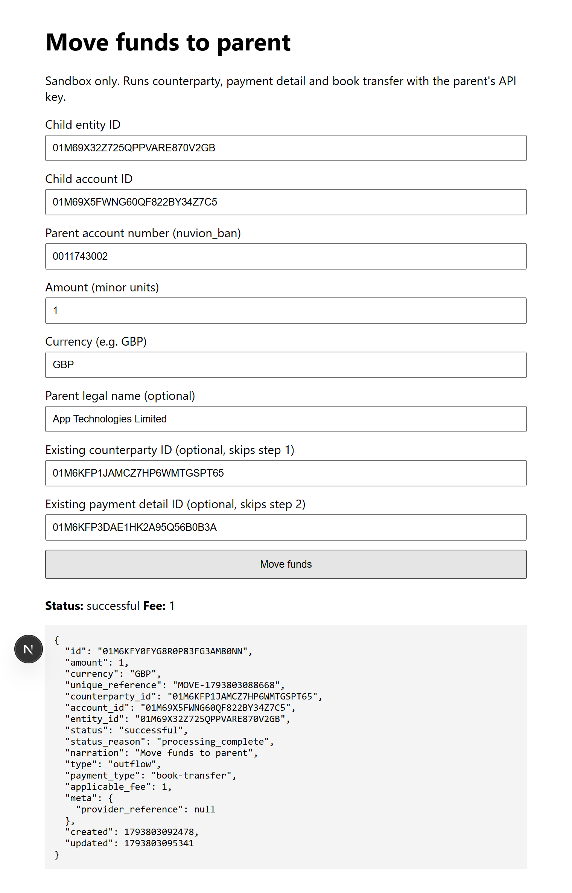

# Nuvion: move funds from a child entity to its parent

A small Next.js (App Router, TypeScript) app that moves funds from a child entity to its parent with the Nuvion sandbox API. It implements the guide [Move funds from a child entity to its parent](https://docs.nuvion.co/guides/move-funds-to-parent).

The sandbox host is `https://api.nuvion.dev`. Use a sandbox key (`nv_test_...`). Do not point this at production.



## Setup

```bash
cp .env.example .env.local
# set NUVION_API_KEY to the parent's sandbox secret key
npm install
npm run dev
```

Open http://localhost:3000.

| Variable | Description |
|---|---|
| `NUVION_API_KEY` | The parent's secret API key. Read only by the route handler, never sent to the browser. Optional if you enter a key in the form's API key field instead. |
| `NUVION_BASE_URL` | Optional. Defaults to `https://api.nuvion.dev`. |

## What the form does

Enter the child entity ID, the child account ID, the parent's `nuvion_ban`, the amount in minor units and the currency. [`app/api/move-funds/route.ts`](app/api/move-funds/route.ts) then calls, with the parent's key and the child's `entity_id`:

1. `POST /counterparties`: creates the parent as a business counterparty under the child. Skipped when you supply a counterparty ID.
2. `POST /payment-details`: adds a `book-transfer` payment detail whose `account_number` is the parent's `nuvion_ban`. Skipped when you supply a payment detail ID.
3. `POST /transfers`: sends a `book-transfer` with a fresh `unique_reference` (`MOVE-<timestamp>`).

The page shows the transfer `status`, `applicable_fee` and the raw response. API errors, such as `409 error_duplicate_resource`, `422` validation errors and `error_transfer_insufficient_funds`, show the API message and the step that failed.

The sender pays the fee on top of the amount, so keep the amount plus `applicable_fee` within the child account's balance.

## Notes

- Each submit creates a new counterparty and payment detail. To move funds again, paste the counterparty ID and payment detail ID from the first run into the optional fields. Adding the same `nuvion_ban` twice returns `422 error_duplicate_resource` on step 2, and the form shows that message.
- No database and no auth layer. This is a demo, not a production service.
